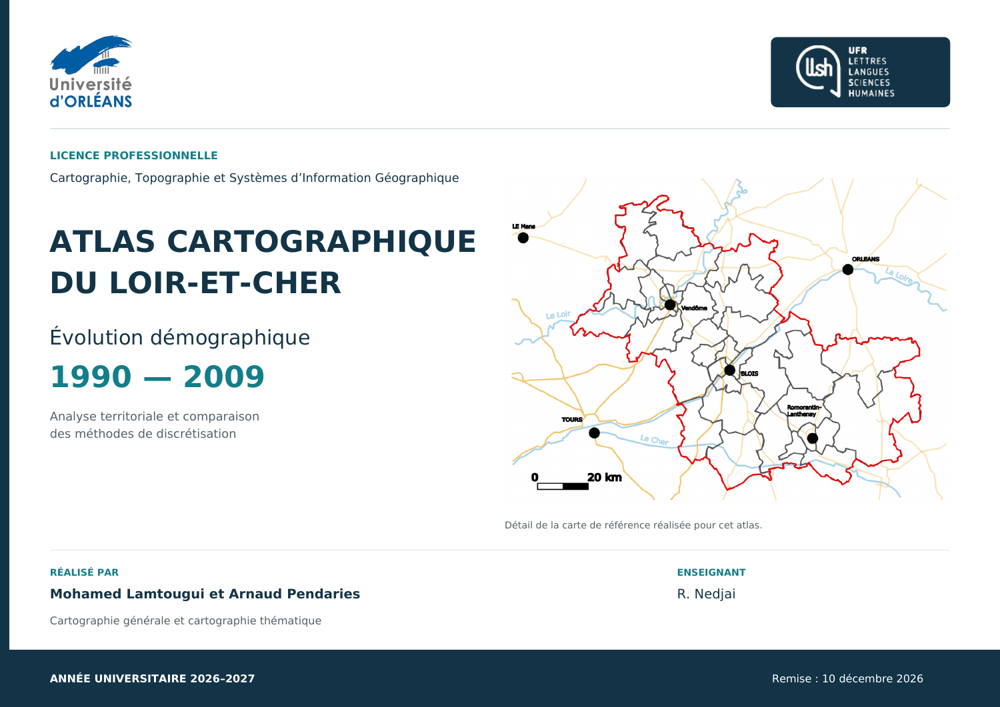

# Atlas cartographique du Loir-et-Cher

[**Consulter l’atlas complet (PDF)**](./Atlas_Loir_et_Cher_Complet.pdf)

## Présentation

Ce projet universitaire étudie l’évolution démographique de 31 unités territoriales du Loir-et-Cher entre 1990 et 2009, sur deux périodes : 1990–1999 et 1999–2009.

L’atlas compare cinq méthodes de discrétisation : les intervalles égaux, l’écart-type, la méthode Q6, l’observation visuelle et la méthode de Jenks. Les cartes réalisées sous Inkscape sont présentées en vis-à-vis avec celles produites sous Philcarto.

La synthèse explique pourquoi la méthode Q6 est retenue pour distinguer les évolutions intermédiaires. L’atlas comprend aussi une carte des trajectoires démographiques et des annexes qui détaillent les seuils et les classes.

## Outils utilisés

- **Excel** : calcul des taux d’évolution et des seuils de classement
- **Inkscape** : réalisation et mise en page des cartes
- **Philcarto** : réalisation des cartes de comparaison

## Auteurs

Mohamed Lamtougui et Arnaud Pendaries  
Licence professionnelle Cartographie, Topographie et SIG — Université d’Orléans
